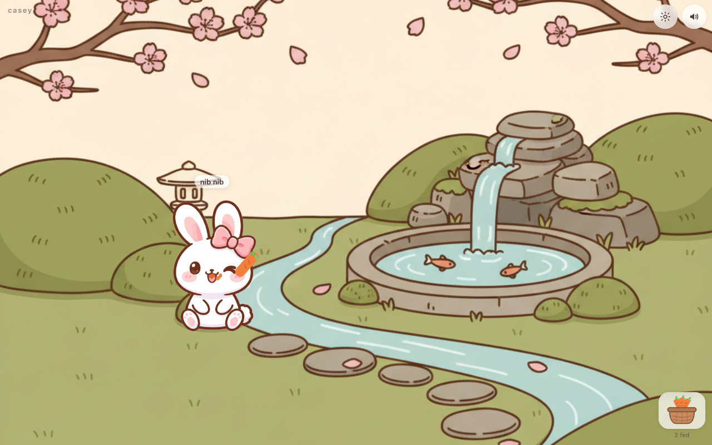
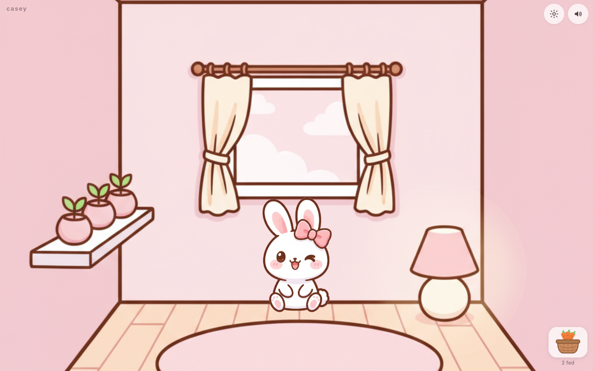
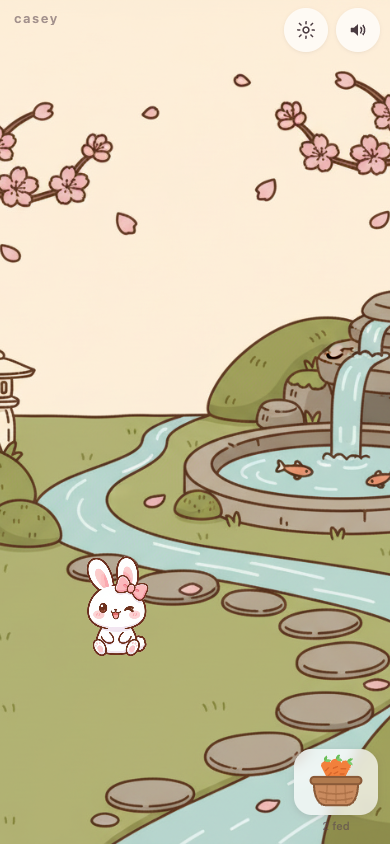

# rabbit-game

A tiny pure-HTML virtual-pet toy: Casey the rabbit. Drag carrots from the
basket to feed her, stroke her head to pet her, and she responds with small
animations and cute noises. Vanilla HTML/CSS/JS — no framework, no build step,
no runtime network. Runs in any modern browser, desktop or mobile.



Status: **v0.2** — real pipeline art (expression frames: blink / ear twitch /
chomp cycle / happy joy), two environments (garden ⇄ pink room), drag-to-mouth
feeding, speech bubbles, pet-quality sensing, an optional clock + calendar.
See `docs/design/rabbit-game/ROADMAP-20261023.md`.

## Quickstart

Native ES modules need a static server (opening via `file://` blocks module loading):

```bash
python3 -m http.server 8000     # then open http://localhost:8000
# or use any static file server
```

Controls: drag a carrot from the basket onto Casey (or tap the basket / press F);
stroke her head (or press P); ESC or the corner button opens settings.

**Live:** https://rabbit.brainvault.xyz/ 🐰 — v1 deployed (Cloudflare Workers
static assets; Git integration: `git push` = deploy; config in `wrangler.jsonc`
+ `.assetsignore`). Locally, the same code runs from any static server.

## Screenshots

| The pink room | On a phone |
| :---: | :---: |
|  |  |

## Layout

The repo root IS the shipped artifact (Q-003 ✅ — split layout, never bundled):

```
index.html          page shell
styles/             CSS
scripts/            vanilla JS ES modules (main, render, input, sound, store, rabbit-state, menu, calendar)
assets/             pipeline-promoted final art (provenance in assets/manifest.json)
docs/design/rabbit-game/   system-forge design: PRD, QUESTIONS, ROADMAP, IDEAS, AGENTS, HANDOFF
art/                production tree: spec → immutable rounds → critique → accepted
tools/              art round generator (local ComfyUI / paid cloud lanes)
```

## Design & pipeline

- `docs/design/rabbit-game/` — full system-forge design set.
- Art pipeline: shotkit brand phase (`docs/design/rabbit-game/SHOTKIT/`) + hybrid
  ComfyUI production (`docs/design/rabbit-game/art/`), adapted from the sibling
  `space-adventure-prototype` repo.
- Agent work rules: see `AGENTS.md` (root) and `docs/design/rabbit-game/AGENTS-20261023.md`.

## Constraints (enforced)

- No frameworks/bundlers/TypeScript; no runtime network requests; no analytics.
- Final game art is produced only through the tracked pipeline with provenance.
- No secrets — this repo is public (github.com/benoahriz/rabbit-game).
